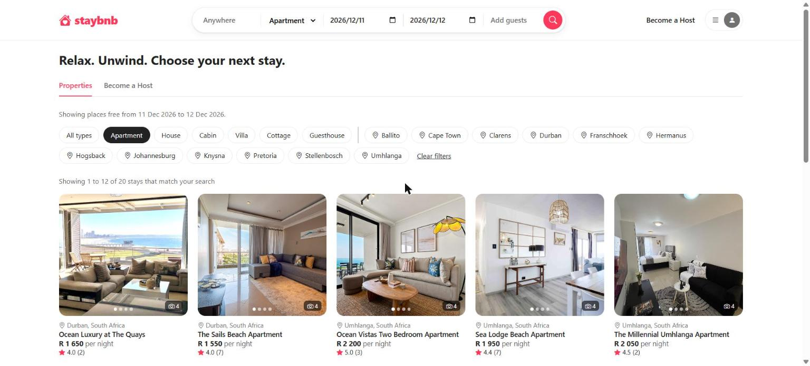
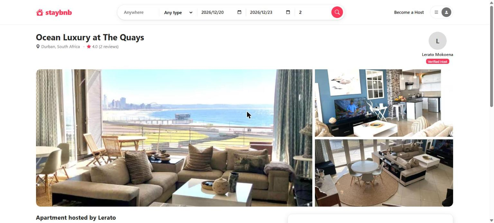

# Staybnb

[](https://github.com/De-Junior/Staybnb/actions/workflows/ci.yml)

An Airbnb-style property rental platform. Guests search and book places, hosts list and manage them, and admins review host applications and oversee the platform. Built with ASP.NET Core MVC (.NET 10), Entity Framework Core and SQL Server, and deployed on Azure.

**Live demo:** https://staybnb-4hv0z.azurewebsites.net/ (hosted on a free Azure tier, so the first load after a quiet period can take about 30 seconds while it wakes up)

## What it does

- **Four roles** (Guest, Host, Admin, SuperAdmin) with role-based authorization and separate dashboards.
- **Search by place and dates.** Guests filter by city, property type, number of guests and the dates they want, and only see places that are free for those nights.
- **Booking engine** that prices a stay, blocks overlapping dates and runs a status flow from request to completed stay.
- **Host onboarding:** guests apply to become hosts with a property and photos, and an admin approves or rejects the application.
- **Online check-in:** after a booking is approved, the guest uploads ID documents that the host verifies. The documents are private.
- **Messaging, notifications and an audit trail** of every important action.

## Screenshots

Searching for apartments free on 11 and 12 December. Places already booked for those nights drop out of the results:



A listing page. The dates and guest count carry over from the search:



## Engineering notes

These are the decisions behind the code, not just the feature list.

- **No double bookings.** A stay holds the calendar for the nights in [check-in, check-out), so one guest can leave on the day another arrives. Approving a request checks the calendar and then takes it, so two approvals for the same property must not run that check at the same time. `BookingApprovalService` locks the property row inside a transaction, which makes concurrent approvals run one after the other. The second one then sees the first booking and is refused.
- **Prices are a snapshot.** A booking stores the nightly price, cleaning fee and service fee it was made with, so later edits to a listing never change past bookings.
- **Role changes are atomic.** Approving a host application activates the property and swaps the Guest role for Host in one database transaction, so a failure can never leave a half-promoted user.
- **Private documents stay private.** ID and passport uploads are stored outside the web root and served by a controller that only allows the guest who uploaded them, the property's host, or an admin.
- **Security by default.** Every POST action validates an anti-forgery token, controllers are locked down with role policies, uploads are checked for type and size, and the app refuses to start without seeded passwords rather than create accounts with a known one.
- **Database rules, not just code rules.** A check constraint rejects a booking that ends before it starts, and ratings are constrained to 1 to 5.
- **Auditable.** Logins, role changes, application decisions, property changes and every booking and check-in step are written to an activity log that admins can filter.

## Tech stack

ASP.NET Core MVC (.NET 10), C#, Entity Framework Core with migrations, SQL Server, ASP.NET Core Identity, Razor views, xUnit with in-memory SQLite for tests, GitHub Actions for CI, Azure App Service for hosting.

## Tests

```
dotnet test
```

The tests run against a real in-memory SQLite database that uses the app's own EF Core model, so the queries and constraints they exercise are the ones the app runs. They cover the price calculation, calendar overlap (including back-to-back stays), booking approval, the host application role swap, and date-based search. GitHub Actions builds and runs them on every push.

## Running the app

Requirements: .NET 10 SDK and SQL Server LocalDB (installed with Visual Studio or SQL Server Express).

Passwords are not stored in the repository. Before the first run, choose a password for the SuperAdmin and one for the demo accounts, and save them as .NET user secrets (they stay on your machine):

```
cd Staybnb
dotnet user-secrets set "Seed:SuperAdmin:Password" "<a strong password>"
dotnet user-secrets set "Seed:DemoPassword" "<a password for the demo accounts>"
dotnet run --launch-profile https
```

When hosting the app, set them as environment variables instead: `Seed__SuperAdmin__Password` and `Seed__DemoPassword`. The app refuses to start without them, rather than create accounts with a known password.

Open https://localhost:7244. On startup the app applies the EF Core migrations, which creates the `StaybnbDb` database. It then seeds the roles, the SuperAdmin, the amenities and some demo data. You don't need to run any SQL scripts.

To use another SQL Server instance, change `ConnectionStrings:DefaultConnection` in `appsettings.json`.

## Seeded accounts

| Role | Email | Password |
|------|-------|----------|
| SuperAdmin | superadmin@staybnb.co.za | `Seed:SuperAdmin:Password` |
| Admin | admin@staybnb.co.za | `Seed:DemoPassword` |
| Host (3 live properties) | host@staybnb.co.za | `Seed:DemoPassword` |
| Guest | guest@staybnb.co.za | `Seed:DemoPassword` |
| Guest with a pending host application | applicant@staybnb.co.za | `Seed:DemoPassword` |

To turn off the demo accounts and properties, set `Seed:DemoData` to `false`. The SuperAdmin is always seeded.

## Features in detail

**Identity and role changes**
- New users are registered with the `Guest` role.
- `Data/RoleSeeder.cs` creates the SuperAdmin on startup.
- When an Admin approves a host application, `Services/HostApplicationService.ApproveAsync` adds the `Host` role and removes `Guest` in the same database transaction.
- Only the SuperAdmin can promote a Guest to Admin (`AdminController.PromoteToAdmin`).
- Roles are reloaded from the database on every request, so a user who was just promoted sees their new dashboard without logging out.
- Controllers are protected with `[Authorize(Roles = ...)]`: `Host` for the host area, `Guest` for booking, check-in and the wishlist, and `Admin,SuperAdmin` for the admin area.

**Host application**
- Guests submit property details plus at least one photo. The server rejects an application that has no image.
- Photos can be JPG, PNG or WEBP, up to 5 MB each. They are stored in `wwwroot/uploads/properties`.
- Hosts can list extra properties, and each one goes through admin approval.

**Host dashboard**
- Shows stats for the host's properties.
- Hosts can edit a listing and toggle whether it is active.
- Hosts can approve or reject booking requests. Approving a request is blocked if its dates overlap another approved booking.
- Hosts can configure each property's check-in steps and verify the documents guests upload.

**Guest experience**
- Guests can browse listings and filter them by city, property type and number of guests.
- Guests can save listings to a wishlist.
- The booking engine calculates `TotalPrice = PricePerNight x Nights + CleaningFee + ServiceFee`. The service fee is 12% of the nights subtotal and can be changed with `Booking:ServiceFeeRate`.
- After a booking is approved, the guest completes a multi-step check-in that includes uploading an ID or passport. These documents are stored privately in `App_Data/documents` and only served to the guest, the host or an admin.
- Booking status flow: Pending, then Approved (payment marked Paid), then CheckedIn (the host verified all documents), then Completed.

**Admin**
- The dashboard shows stats, recent activity, host applications and bookings.
- Admins can review applications and search users.
- The SuperAdmin can promote Guests to Admin.
- Admins can view the activity log, filtered and paginated.

**Messaging and notifications**
- Users have a database-backed inbox. Opening a conversation marks its messages as read.
- The notification bell shows unread items. Admins can filter notifications by all, unread, read or today, mark them read, mark all read, delete them, and use "Take Action".

**Activity logging** (`Services/ActivityLogger.cs`)
- Logs registrations, logins, failed logins and logouts.
- Logs role changes, host application submissions and decisions, and property changes.
- Logs every booking status change and check-in step.

## Database migrations

The migrations are in `Migrations/`. To recreate the database manually:

```
dotnet tool restore
dotnet ef database update
```
